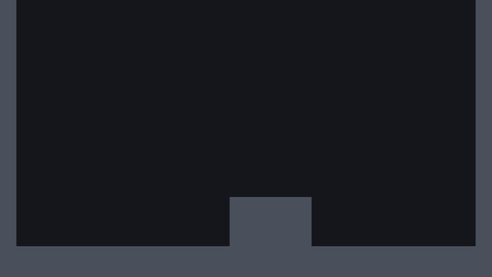

# الدرس 01: أول مشهد والأرضية

**الهدف:** تسوي «قطعة أرض» تقدر تكررها وتغيّر حجمها، وتبني فيها أول غرفة.
**الوقت:** حوالي 45 دقيقة.
**قبله:** [الدرس 00](00-setup.md)

---

## الفكرة

الغرفة مبنية من مستطيلات: أرضية وجدران ودرجة. بدل ما نبني كل مستطيل من الصفر، نسوي **مشهد واحد اسمه Block** ونكرره، وكل نسخة نعطيها حجمها من الـ Inspector.

بنستخدم ثلاث عُقد:

| العقدة | وش تسوي |
|---|---|
| `StaticBody2D` | جسم صلب ما يتحرك، زي الأرض والجدار. الرحّال يوقف عليه وما يخترقه |
| `CollisionShape2D` | الشكل اللي يستخدمه Godot عشان يعرف وين الاصطدام. ما ينرسم في اللعبة |
| `ColorRect` | مستطيل ملوّن. هذا اللي تشوفه بعينك |

`StaticBody2D` بروحه ما يعرف حجمه. `CollisionShape2D` يعطيه الشكل، و `ColorRect` يعطيه الشكل اللي ينشاف.

## 1. سوّ مشهد القطعة

1. من القائمة: **Scene → New Scene**.
2. في **Scene** (فوق يسار) اضغط **Other Node**، واكتب في البحث `StaticBody2D`، واختره، واضغط **Create**.
3. اضغط على العقدة مرتين (أو F2) وغيّر اسمها لـ `Block`.
4. وهي محددة، اضغط زر **+** فوق شجرة العُقد (أو Ctrl+A)، وأضف `CollisionShape2D`.
   - بيطلع جنبها مثلث أصفر فيه تحذير. عادي، السكربت بيحل المشكلة بعد شوي.
5. حدد `Block` مرة ثانية، وأضف `ColorRect`.

لازم تكون الشجرة كذا (الاثنين تحت `Block` مباشرة):

```
Block (StaticBody2D)
├─ CollisionShape2D
└─ ColorRect
```

6. احفظ بـ **Ctrl+S**، واختر مجلد `scenes`، وسمّه `block.tscn`.

## 2. أول سكربت: قطعة تعرف حجمها

السكربت هو الكود اللي يعطي العقدة تصرفات. بنكتب سكربت يخلّي القطعة تضبط شكل التصادم والمستطيل الملوّن على نفس الحجم.

1. حدد `Block`، واضغط زر **Attach Script** (أيقونة ورقة عليها + خضراء، فوق شجرة العُقد).
2. في **Path** اكتب: `res://scripts/block.gd`، واضغط **Create**.
3. بيفتح محرر الكود وفيه كود جاهز. حدد كل شي بـ **Ctrl+A** واحذفه، والصق هذا:

`scripts/block.gd`

```gdscript
@tool
extends StaticBody2D
## قطعة أرض أو جدار. غيّر الحجم واللون من الـ Inspector.

# حجم القطعة بالبكسل (العرض، الطول)
@export var size := Vector2(256, 64):
	set(value):
		size = value
		update_block()

# لون القطعة
@export var color := Color("4a4f5c"):
	set(value):
		color = value
		update_block()


func _ready() -> void:
	update_block()


func update_block() -> void:
	# Godot يضبط الخصائص قبل ما تجهز العُقد الأبناء، فنتأكد إنها جاهزة
	if not is_node_ready():
		return
	# نسوي شكل تصادم جديد لكل قطعة، عشان ما تتشارك القطع نفس الحجم
	var shape := RectangleShape2D.new()
	shape.size = size
	$CollisionShape2D.shape = shape
	# مركز شكل التصادم في نص القطعة، والزاوية اليسرى العليا عند نقطة الأصل
	$CollisionShape2D.position = size / 2.0
	$ColorRect.size = size
	$ColorRect.color = color
```

4. احفظ بـ **Ctrl+S**.

لو ما تغيّر شي في مشهد القطعة، روح لـ **Scene → Reload Saved Scene**. بعدها بتشوف مستطيل رمادي 256×64، والمثلث الأصفر بيختفي.

### وش يسوي هالكود؟ سطر سطر

```gdscript
@tool
```
عادةً الكود يشتغل بس وقت اللعب. `@tool` يخليه يشتغل **داخل المحرر** بعد، عشان تشوف الحجم يتغيّر وأنت تعدّل.

```gdscript
extends StaticBody2D
```
يعني هالسكربت «نوع خاص» من `StaticBody2D`. كل اللي يقدر عليه `StaticBody2D`، يقدر عليه سكربتنا، وفوقه اللي بنضيفه.

```gdscript
@export var size := Vector2(256, 64):
```
- `var` يعني **متغيّر**: صندوق باسم `size` نحفظ فيه قيمة.
- `Vector2(256, 64)` رقمين مع بعض: العرض 256 والطول 64.
- `@export` يخلّي المتغيّر يطلع في الـ **Inspector** عشان تغيّره بدون ما تفتح الكود.

```gdscript
	set(value):
		size = value
		update_block()
```
هذا **setter**: كود يشتغل كل ما تغيّرت القيمة. يحفظ الحجم الجديد، ويستدعي `update_block()` عشان يحدّث الشكل.

> **المسافات في بداية السطر مهمة.** GDScript يعرف وش داخل وش من المسافة (Tab). `set` داخل المتغيّر، والسطرين تحته داخل `set`.

```gdscript
func _ready() -> void:
	update_block()
```
`func` يعني **دالة**: مجموعة أوامر لها اسم. `_ready` دالة يستدعيها Godot لحاله أول ما تجهز العقدة.

```gdscript
	var shape := RectangleShape2D.new()
	shape.size = size
	$CollisionShape2D.shape = shape
```
نسوي شكل تصادم مستطيل جديد بنفس الحجم ونعطيه لـ `CollisionShape2D`. علامة `$` معناها «العقدة الابن اللي اسمها كذا»، فلازم الأسماء تطابق الشجرة بالضبط.

```gdscript
	$CollisionShape2D.position = size / 2.0
```
شكل التصادم يتمركز على نقطته، والمستطيل الملوّن يبدأ من زاويته اليسرى العليا. فنحرّك شكل التصادم لنص المستطيل عشان يتطابقون.

## 3. سوّ مشهد الغرفة

1. **Scene → New Scene**.
2. اضغط **2D Scene**. بتطلع عقدة `Node2D`، غيّر اسمها لـ `TestRoom`.
3. احفظ في `scenes` باسم `test_room.tscn`.

## 4. حط القطع

1. حدد `TestRoom`.
2. من **FileSystem**، اسحب `block.tscn` وأفلته في الـ Viewport. بتطلع قطعة جديدة تحت `TestRoom`.
3. كرر لين يصير عندك 4 قطع.
4. حدد كل قطعة، وغيّر اسمها ومكانها وحجمها من الـ **Inspector**:
   - المكان: **Transform → Position**
   - الحجم: **Size** (تحت اسم السكربت `block.gd` فوق في الـ Inspector)

| الاسم | Position (x, y) | Size (x, y) |
|---|---|---|
| `Floor` | 0, 960 | 1920, 192 |
| `LeftWall` | 0, 0 | 64, 960 |
| `RightWall` | 1856, 0 | 64, 960 |
| `Step` | 896, 768 | 320, 192 |

### كيف تشتغل الإحداثيات؟

- **x** يزيد كل ما رحت **يمين**.
- **y** يزيد كل ما رحت **تحت**. (عكس دروس الرياضيات!)
- النقطة (0, 0) فوق يسار.
- المستطيل البنفسجي الخفيف في الـ Viewport هو حدود الشاشة: 1920×1080.

يعني الأرضية تبدأ عند y = 960، قريب من تحت الشاشة، والدرجة طولها 192 وواقفة عليها.

> **نصيحة:** فعّل الالتصاق بالشبكة من زر الشبكة/المغناطيس فوق الـ Viewport، وخلّ **Configure Snap** على 64. كذا القطع تترتب بسهولة.

## 5. شغّل

1. احفظ (Ctrl+S).
2. اضغط **F6** (Run Current Scene).

بتطلع نافذة فيها أرضية وجدارين ودرجة على خلفية غامقة. ما فيه حركة للحين، هذا طبيعي.



خلّ الغرفة هي المشهد الرئيسي: اضغط **F5**، وإذا سألك عن المشهد الرئيسي اختر **Select Current**. بعدها F5 يشغّل الغرفة على طول.

---

## ✔ تأكد قبل ما تكمل

- [ ] `block.tscn` فيه `Block` وتحته `CollisionShape2D` و `ColorRect`.
- [ ] تغيّر الـ Size في الـ Inspector، والمستطيل يتغيّر قدامك.
- [ ] الغرفة فيها 4 قطع بنفس الأرقام اللي في الجدول.
- [ ] F5 يشغّل الغرفة.

## لو واجهتك مشكلة

- **المستطيل ما يتغير وأنت تعدّل الحجم:** تأكد إن `@tool` أول سطر في السكربت، واحفظ، وبعدين **Scene → Reload Saved Scene**.
- **خطأ فيه `Node not found: "CollisionShape2D"`:** أسماء العُقد في الشجرة لازم تطابق الكود بالضبط، حتى الحروف الكبيرة.
- **خطأ `Used space character for indentation instead of tab`:** المسافات في بداية بعض الأسطر مخلوطة. من قائمة **Edit** في محرر الكود اختر **Convert Indent to Tabs** (ممكن تلقاه داخل **Indentation**).

## تحدّي (اختياري)

- غيّر لون الدرجة من خاصية **Color** في الـ Inspector.
- أضف منصة صغيرة طايرة في الهوا. (احذفها بعدين عشان ما تخرب أرقام الدروس الجاية.)

## الدرس الجاي

[الدرس 02: الرحّال والأزرار](02-player.md)
