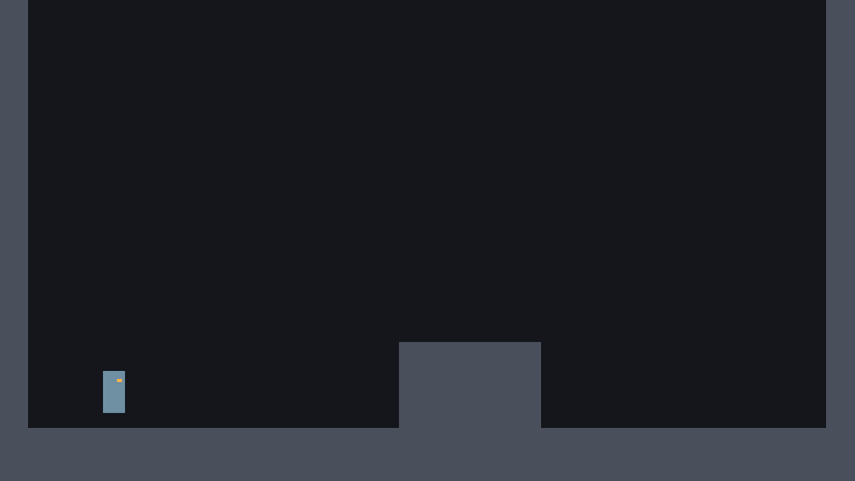

# الدرس 02: الرحّال والأزرار

**الهدف:** تسوي مشهد الرحّال بشكل مؤقت، وتحطه في الغرفة، وتجهّز أزرار التحكم.
**الوقت:** حوالي 45 دقيقة.
**قبله:** [الدرس 01](01-room.md)

---

## الفكرة

الرحّال يحتاج عقدة تعرف تتحرك وتصطدم بالأرض والجدران. هذي اسمها `CharacterBody2D`: جسم **احنا** نحرّكه بالكود (مو الجاذبية الجاهزة)، وهي توقّفه لما يصطدم.

الشكل الحين مستطيل ملوّن، وفيه «عين» صغيرة عشان نعرف وين يطالع. الرسم الحقيقي يجي بعدين.

## 1. سوّ مشهد الرحّال

1. **Scene → New Scene** ثم **Other Node** واختر `CharacterBody2D`. سمّه `Player`.
2. أضف تحته `CollisionShape2D`:
   - في الـ Inspector، عند **Shape** اضغط `<empty>` واختر **New RectangleShape2D**.
   - اضغط على الشكل اللي طلع، وخلّ **Size**: `48, 96`.
   - هذا جسم الرحّال بالنسبة للاصطدام: عرضه 48 وطوله 96.
3. حدد `Player` وأضف تحته `Node2D`، وسمّه `Body`.
   - **Position:** `0, 48`
   - نقطة `Body` صارت عند **رجول** الرحّال. بنستفيد منها في الدرس 08 لما نمدّ الشكل ونضغطه، فيضل واقف على الأرض.
4. حدد `Body` وأضف تحته `ColorRect`، وسمّه `Cloak` (العباءة):
   - **Layout → Transform → Position:** `-24, -96`
   - **Layout → Transform → Size:** `48, 96`
   - **Color:** `6f8fa3`
5. حدد `Body` مرة ثانية وأضف `ColorRect` ثاني، وسمّه `Eye` (العين):
   - **Position:** `6, -78`
   - **Size:** `12, 8`
   - **Color:** `ffb347`

لازم تكون الشجرة كذا بالضبط:

```
Player (CharacterBody2D)
├─ CollisionShape2D
└─ Body (Node2D)
   ├─ Cloak (ColorRect)
   └─ Eye (ColorRect)
```

6. احفظ في `scenes` باسم `player.tscn`.

> **ليش العين على اليمين؟** لما الرحّال يلف يسار، بنقلب `Body` كله، فتروح العين يسار. كذا نعرف اتجاهه.

## 2. حط الرحّال في الغرفة

1. افتح `test_room.tscn` (دبل كليك عليه في FileSystem).
2. حدد `TestRoom`، واسحب `player.tscn` للـ Viewport.
3. خلّ **Position** حقه: `256, 880`.
4. احفظ وشغّل (F5).

بتشوف الرحّال واقف في الهوا فوق الأرض بشوي، وما يتحرك ولا يطيح. **هذا طبيعي.** ما عنده كود للحين، وبنكتبه في الدرس الجاي.



## 3. جهّز الأزرار (Input Map)

بدل ما نكتب في الكود «لو ضغط حرف A»، نعطي كل فعل **اسم** (مثلاً `jump`)، ونربط فيه أكثر من زر. الكود يسأل عن الاسم بس. كذا تقدر بعدين تغيّر الأزرار بدون ما تلمس الكود.

افتح **Project → Project Settings** وروح لتبويب **Input Map**.

### كيف تضيف فعل

1. في خانة **Add New Action** اكتب اسم الفعل (مثلاً `move_left`) واضغط **Add**.
2. جنب الفعل الجديد، اضغط **+**.
3. بتفتح نافذة تسمع: اضغط الزر في الكيبورد، أو حرّك العصا أو اضغط الزر في يد التحكم، واضغط **OK**.
4. كرر الخطوتين 2 و 3 لكل زر ثاني لنفس الفعل.

### الأفعال

| الفعل (بالإنجليزي بالضبط) | الكيبورد | يد التحكم |
|---|---|---|
| `move_left` | A ، السهم اليسار | العصا اليسرى لليسار ، D-pad Left |
| `move_right` | D ، السهم اليمين | العصا اليسرى لليمين ، D-pad Right |
| `move_up` | W ، السهم فوق | العصا اليسرى لفوق ، D-pad Up |
| `move_down` | S ، السهم تحت | العصا اليسرى لتحت ، D-pad Down |
| `jump` | K ، Z ، Space | زر A (الزر اللي تحت) |
| `dash` | L ، C | Right Trigger (RT) |
| `attack` | J ، X | زر X (الزر اللي يسار) |

- `move_up` و `move_down` و `attack` ما بنستخدمها في غرفة التجربة، بس نجهزها من الحين للمراحل الجاية.
- إذا ما عندك يد تحكم، تجاهل عمود يد التحكم.

### مهم: الحروف والكيبورد العربي

لما تضيف حرف، شوف أسفل نافذة الزر. لو فيه قائمة نوع الزر، اختر **Physical Keycode (Position on US QWERTY Keyboard)**.

هذا يخلّي Godot يعرف الزر من **مكانه** في الكيبورد، مو من الحرف المكتوب عليه. فلو كان الكيبورد على العربي، زر A (اللي عليه «ش») بيشتغل عادي.

---

## ✔ تأكد قبل ما تكمل

- [ ] شجرة `player.tscn` مطابقة للرسمة فوق، والأسماء نفسها بالضبط (`Body` بحرف B كبير).
- [ ] الرحّال يطلع في الغرفة لما تشغّل.
- [ ] في **Input Map** سبعة أفعال بأسماء الجدول بالضبط.

## لو واجهتك مشكلة

- **الرحّال ما يطلع:** تأكد إن `Cloak` تحت `Body`، وإن Size حقه `48, 96` مو صفر.
- **الرحّال يطلع بعيد عن مكانه:** تأكد إنك غيّرت Position حق `Player` نفسه في الغرفة، مو حق `Body`.
- **ما طلعت قائمة Physical Keycode:** عادي، بعض النسخ تحطه كخيار **Physical**. فعّله إذا لقيته.

## الدرس الجاي

[الدرس 03: الجري والجاذبية](03-run.md)
