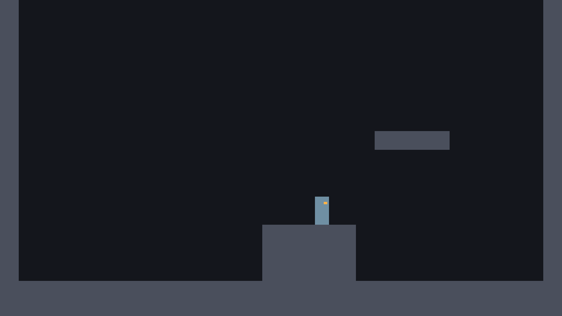

# الدرس 05: القفزة المزدوجة

**الهدف:** قفزة ثانية في الهوا، ومفتاح تشغّل فيه القدرة وتطفيها.
**الوقت:** حوالي 30 دقيقة.
**قبله:** [الدرس 04](04-jump.md)

---

## الفكرة

نعدّ كم قفزة باقية للرحّال وهو في الهوا. كل ما لمس الأرض، نرجّع العدد لـ 1. لما يضغط قفز في الهوا والعدد أكبر من صفر، يقفز وننقّص العدد.

ونضيف قسم **القدرات** فوق السكربت. في اللعبة الحقيقية الرحّال ما يبدأ بالقفزة المزدوجة. يكسبها في كهوف الكريستال المغنّي (شوف [وثيقة التصميم](../docs/GDD.md)). فنخليها مفتاح `can_double_jump` نقدر نطفيه ونشغّله.

## 1. أضف منصة عالية

في `test_room.tscn` أضف قطعة جديدة من `block.tscn`:

| الاسم | Position | Size |
|---|---|---|
| `HighPlatform` | 1280, 448 | 256, 64 |



المنصة أعلى من الدرجة بـ 320 بكسل. القفزة العادية توصل 250 تقريباً، يعني من فوق الدرجة ما توصل لها إلا بقفزة مزدوجة.

## 2. الإضافات في السكربت

### قسم القدرات (أول السكربت)

تحت سطر `## الرحّال...` وقبل قسم الجري:

```gdscript
# ===== القدرات (شغّلها أو طفّها من الـ Inspector) =====
@export var can_double_jump := true
```

### قسم القفزة المزدوجة

تحت قسم القفز:

```gdscript
# ===== القفزة المزدوجة =====
@export var double_jump_velocity := -1150.0
@export var max_air_jumps := 1
```
- القفزة الثانية أضعف شوي من الأولى (-1150 بدل -1300).
- `max_air_jumps` لو خلّيته 2، تصير قفزة ثلاثية.

وتحت العدّادات:

```gdscript
var air_jumps_left := 0
```

### نرجّع القفزات لما يلمس الأرض

في `update_timers`:

```gdscript
	if is_on_floor():
		# على الأرض: نرجّع كل شي يتجدد بلمس الأرض
		coyote_timer = coyote_time
		air_jumps_left = max_air_jumps
	else:
		coyote_timer -= delta
```

### القفزة الثانية

في `handle_jump`، تحت سطر `jump(jump_velocity)`:

```gdscript
	if jump_buffer_timer > 0.0 and coyote_timer > 0.0:
		jump(jump_velocity)
	elif Input.is_action_just_pressed("jump") and can_double_jump and air_jumps_left > 0:
		air_jumps_left -= 1
		jump(double_jump_velocity)
```
- `elif` يعني «وإذا ما صار اللي فوق، جرّب هذا». فالقفزة المزدوجة ما تصير إلا إذا ما قدرت تقفز من الأرض.
- `and` يعني لازم كل الشروط تكون صح: ضغطت الحين، والقدرة شغّالة، وباقي لك قفزة.
- لاحظ: هنا نستخدم `is_action_just_pressed`، فالقفزة المزدوجة تصير بنفس اللحظة اللي تضغط فيها وأنت في الهوا. وإذا ما باقي لك قفزات، الضغطة تنحفظ في عدّاد الـ buffer وتقفز أول ما تلمس الأرض.

## 3. السكربت كامل لين هالدرس

`scripts/player.gd`

```gdscript
extends CharacterBody2D
## الرحّال: كل حركة البطل في هذا السكربت.

# ===== القدرات (شغّلها أو طفّها من الـ Inspector) =====
@export var can_double_jump := true

# ===== الجري =====
# أقصى سرعة جري (بكسل في الثانية)
@export var max_speed := 520.0
# كم بسرعة يوصل للسرعة القصوى
@export var acceleration := 5000.0
# كم بسرعة يوقف لما تفك الزر
@export var friction := 6000.0

# ===== الجاذبية =====
@export var gravity := 3400.0
# الجاذبية وقت النزول أقوى، عشان القفزة ما تحس إنها عايمة
@export var fall_gravity_multiplier := 1.6
@export var max_fall_speed := 1300.0

# ===== القفز =====
# سالب لأن فوق في Godot يعني y أصغر
@export var jump_velocity := -1300.0
# لو فكّيت زر القفز بدري، نضرب السرعة في هالرقم فتصير القفزة قصيرة
@export var jump_cut_multiplier := 0.45
# وقت سماح تقدر تقفز فيه بعد ما تطلع من الحافة
@export var coyote_time := 0.1
# لو ضغطت قفز قبل ما تلمس الأرض بشوي، نتذكر الضغطة هالمدة
@export var jump_buffer_time := 0.12

# ===== القفزة المزدوجة =====
@export var double_jump_velocity := -1150.0
@export var max_air_jumps := 1

# اتجاه الرحّال: 1 يمين، -1 يسار
var facing := 1
var coyote_timer := 0.0
var jump_buffer_timer := 0.0
var air_jumps_left := 0

@onready var body: Node2D = $Body


func _physics_process(delta: float) -> void:
	update_timers(delta)
	apply_gravity(delta)
	handle_run(delta)
	handle_jump()
	move_and_slide()
	update_visual()


func update_timers(delta: float) -> void:
	jump_buffer_timer -= delta
	if is_on_floor():
		# على الأرض: نرجّع كل شي يتجدد بلمس الأرض
		coyote_timer = coyote_time
		air_jumps_left = max_air_jumps
	else:
		coyote_timer -= delta


func apply_gravity(delta: float) -> void:
	if is_on_floor():
		return
	var current_gravity := gravity
	if velocity.y > 0.0:
		current_gravity *= fall_gravity_multiplier
	velocity.y = minf(velocity.y + current_gravity * delta, max_fall_speed)


func handle_run(delta: float) -> void:
	var direction := Input.get_axis("move_left", "move_right")
	if direction != 0.0:
		velocity.x = move_toward(velocity.x, direction * max_speed, acceleration * delta)
		facing = 1 if direction > 0.0 else -1
	else:
		velocity.x = move_toward(velocity.x, 0.0, friction * delta)


func handle_jump() -> void:
	if Input.is_action_just_pressed("jump"):
		jump_buffer_timer = jump_buffer_time

	if jump_buffer_timer > 0.0 and coyote_timer > 0.0:
		jump(jump_velocity)
	elif Input.is_action_just_pressed("jump") and can_double_jump and air_jumps_left > 0:
		air_jumps_left -= 1
		jump(double_jump_velocity)

	# قفزة قصيرة: لو فكّيت الزر والرحّال لسا طالع، نقص سرعته
	if Input.is_action_just_released("jump") and velocity.y < 0.0:
		velocity.y *= jump_cut_multiplier


func jump(strength: float) -> void:
	velocity.y = strength
	jump_buffer_timer = 0.0
	coyote_timer = 0.0


func update_visual() -> void:
	body.scale.x = facing
```

## 4. جرّب الحين

- اقفز، واضغط قفز مرة ثانية في الهوا. بيقفز مرة ثانية.
- الضغطة الثالثة ما تسوي شي.
- اطلع على الدرجة، وبعدها على `HighPlatform` بقفزة وقفزة مزدوجة. اقفز من طرف الدرجة، وسوّ القفزة الثانية قبل ما تصير تحت المنصة، وبعدين روح يمين لفوقها.
- حدد `Player` في الغرفة، وطفّ **Can Double Jump** من الـ Inspector. حاول توصل المنصة الحين. ما تقدر.

هذي فكرة ألعاب Metroidvania كلها: **مكان تشوفه وما توصل له، لين تكسب القدرة.**

---

## ✔ تأكد قبل ما تكمل

- [ ] فيه قفزة ثانية وحدة بس في الهوا.
- [ ] توصل `HighPlatform` من الدرجة بالقفزة المزدوجة، وما توصلها بدونها.
- [ ] رجّعت **Can Double Jump** شغّال.

## لو واجهتك مشكلة

- **يقفز في الهوا بلا نهاية:** تأكد إن `air_jumps_left -= 1` موجود قبل `jump(double_jump_velocity)`.
- **ما فيه قفزة ثانية أبد:** تأكد إن `air_jumps_left = max_air_jumps` داخل `if is_on_floor():` في `update_timers`.

## الدرس الجاي

[الدرس 06: الاندفاع](06-dash.md)
