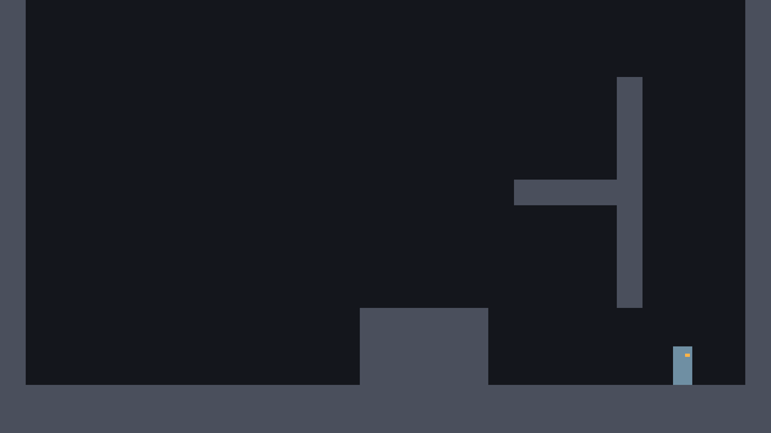

# الدرس 07: الجدار

**الهدف:** الرحّال ينزلق ببطء على الجدار ويقفز منه، فيقدر يطلع بين جدارين.
**الوقت:** حوالي 45 دقيقة.
**قبله:** [الدرس 06](06-dash.md)

---

## الفكرة

**الانزلاق:** لو الرحّال في الهوا، ولاصق في جدار، وضاغط باتجاهه، ينزل ببطء بدل ما يطيح.

**القفز من الجدار:** وهو منزلق، لو ضغط قفز، ينطلق لفوق **وبعيد** عن الجدار. وعشان الدفعة ما تضيع، نوقف أزرار الجري لحظة قصيرة (0.15 ثانية) بعد القفزة.

**كيف نعرف وين الجدار؟** Godot يعطينا `get_wall_normal()`: سهم يطلع من الجدار باتجاهك.

```
  wall on the LEFT                      wall on the RIGHT
  #                                                     #
  # [P]  normal --> (+1)          (-1) <-- normal  [P]  #
  #                                                     #
```

`[P]` هو الرحّال، و `#` الجدار.

- لو الجدار يسار، السهم يأشر يمين (`+1`).
- لو الجدار يمين، السهم يأشر يسار (`-1`).

**ضاغط باتجاه الجدار** يعني ضغطك عكس السهم. وبالأرقام: `direction * normal.x` يطلع **سالب**.

ولمس الجدار يرجّع لك القفزة المزدوجة والاندفاعة الهوائية، زي Hollow Knight.

## 1. سوّ بئر للتجربة

في `test_room.tscn` أضف قطعة:

| الاسم | Position | Size |
|---|---|---|
| `ClimbWall` | 1536, 192 | 64, 576 |



صار عندك بئر عرضه 256 بين `ClimbWall` و `RightWall`. `ClimbWall` ما يوصل للأرض، فتحته فتحة تدخل منها للبئر.

## 2. الإضافات

### القدرة والأرقام

في قسم القدرات:

```gdscript
@export var can_wall_jump := true
```

تحت قسم الاندفاع (وقبل `enum State`):

```gdscript
# ===== الجدار =====
@export var wall_slide_speed := 220.0
# x: قوة الدفعة بعيد عن الجدار، y: قوة القفزة لفوق
@export var wall_jump_velocity := Vector2(650.0, -1150.0)
# بعد القفز من الجدار، نوقف التحكم هالمدة عشان الدفعة تكمل
@export var wall_jump_lock_time := 0.15
```

وتحت العدّادات:

```gdscript
var is_wall_sliding := false
var wall_jump_lock_timer := 0.0
```

### عدّاد القفل

في `update_timers`، تحت `dash_cooldown_timer -= delta`:

```gdscript
	wall_jump_lock_timer -= delta
```

### نوقف الجري وقت القفل

في أول `handle_run`:

```gdscript
func handle_run(delta: float) -> void:
	if wall_jump_lock_timer > 0.0:
		return
```

### الانزلاق

دالة جديدة (حطها قبل `handle_jump`):

```gdscript
func handle_wall_slide() -> void:
	is_wall_sliding = false
	if not can_wall_jump or not is_on_wall_only():
		return
	var direction := Input.get_axis("move_left", "move_right")
	var wall_normal := get_wall_normal()
	# الـ normal سهم يطلع من الجدار. لو ضغطك عكسه، يعني أنت ضاغط على الجدار
	if direction * wall_normal.x < 0.0:
		is_wall_sliding = true
		velocity.y = minf(velocity.y, wall_slide_speed)
		# يطالع بعيد عن الجدار
		facing = 1 if wall_normal.x > 0.0 else -1
		# لمس الجدار يرجّع القفزة المزدوجة والاندفاع
		air_jumps_left = max_air_jumps
		can_air_dash = true
```
- `is_on_wall_only()` صح لو لاصق في جدار **ومو** على الأرض.
- `minf(velocity.y, wall_slide_speed)` ما يخلّي سرعة النزول تتعدى 220. ولو كان طالع (سرعة سالبة) ما يتأثر.
- الرحّال يطالع بعيد عن الجدار، فلو اندفع وهو منزلق يندفع بعيد عنه.

وأضفها في `normal_state` بعد الجري:

```gdscript
func normal_state(delta: float) -> void:
	apply_gravity(delta)
	handle_run(delta)
	handle_wall_slide()
	handle_jump()
	handle_dash()
```

### القفز من الجدار

في `handle_jump`، بين القفزة العادية والمزدوجة:

```gdscript
	if jump_buffer_timer > 0.0 and coyote_timer > 0.0:
		jump(jump_velocity)
	elif jump_buffer_timer > 0.0 and is_wall_sliding:
		wall_jump()
	elif Input.is_action_just_pressed("jump") and can_double_jump and air_jumps_left > 0:
```

ودالة جديدة تحت `jump`:

```gdscript
func wall_jump() -> void:
	var push := get_wall_normal().x
	velocity.x = push * wall_jump_velocity.x
	velocity.y = wall_jump_velocity.y
	facing = 1 if push > 0.0 else -1
	wall_jump_lock_timer = wall_jump_lock_time
	jump_buffer_timer = 0.0
	is_wall_sliding = false
```
`push` هو اتجاه السهم (+1 أو -1)، فنضربه في قوة الدفعة عشان يطير بعيد عن الجدار.

## 3. السكربت كامل لين هالدرس

`scripts/player.gd`

```gdscript
extends CharacterBody2D
## الرحّال: كل حركة البطل في هذا السكربت.

# ===== القدرات (شغّلها أو طفّها من الـ Inspector) =====
@export var can_double_jump := true
@export var can_dash := true
@export var can_wall_jump := true

# ===== الجري =====
# أقصى سرعة جري (بكسل في الثانية)
@export var max_speed := 520.0
# كم بسرعة يوصل للسرعة القصوى
@export var acceleration := 5000.0
# كم بسرعة يوقف لما تفك الزر
@export var friction := 6000.0

# ===== الجاذبية =====
@export var gravity := 3400.0
# الجاذبية وقت النزول أقوى، عشان القفزة ما تحس إنها عايمة
@export var fall_gravity_multiplier := 1.6
@export var max_fall_speed := 1300.0

# ===== القفز =====
# سالب لأن فوق في Godot يعني y أصغر
@export var jump_velocity := -1300.0
# لو فكّيت زر القفز بدري، نضرب السرعة في هالرقم فتصير القفزة قصيرة
@export var jump_cut_multiplier := 0.45
# وقت سماح تقدر تقفز فيه بعد ما تطلع من الحافة
@export var coyote_time := 0.1
# لو ضغطت قفز قبل ما تلمس الأرض بشوي، نتذكر الضغطة هالمدة
@export var jump_buffer_time := 0.12

# ===== القفزة المزدوجة =====
@export var double_jump_velocity := -1150.0
@export var max_air_jumps := 1

# ===== الاندفاع =====
@export var dash_speed := 1400.0
@export var dash_duration := 0.18
@export var dash_cooldown := 0.4

# ===== الجدار =====
@export var wall_slide_speed := 220.0
# x: قوة الدفعة بعيد عن الجدار، y: قوة القفزة لفوق
@export var wall_jump_velocity := Vector2(650.0, -1150.0)
# بعد القفز من الجدار، نوقف التحكم هالمدة عشان الدفعة تكمل
@export var wall_jump_lock_time := 0.15

# حالات الرحّال: يا يتحرك عادي، يا يندفع
enum State { NORMAL, DASH }
var state := State.NORMAL

# اتجاه الرحّال: 1 يمين، -1 يسار
var facing := 1
var coyote_timer := 0.0
var jump_buffer_timer := 0.0
var air_jumps_left := 0
var dash_timer := 0.0
var dash_cooldown_timer := 0.0
var can_air_dash := true
var is_wall_sliding := false
var wall_jump_lock_timer := 0.0

@onready var body: Node2D = $Body


func _physics_process(delta: float) -> void:
	update_timers(delta)
	match state:
		State.NORMAL:
			normal_state(delta)
		State.DASH:
			dash_state(delta)
	move_and_slide()
	update_visual()


func update_timers(delta: float) -> void:
	jump_buffer_timer -= delta
	dash_cooldown_timer -= delta
	wall_jump_lock_timer -= delta
	if is_on_floor():
		# على الأرض: نرجّع كل شي يتجدد بلمس الأرض
		coyote_timer = coyote_time
		air_jumps_left = max_air_jumps
		can_air_dash = true
	else:
		coyote_timer -= delta


func normal_state(delta: float) -> void:
	apply_gravity(delta)
	handle_run(delta)
	handle_wall_slide()
	handle_jump()
	handle_dash()


func apply_gravity(delta: float) -> void:
	if is_on_floor():
		return
	var current_gravity := gravity
	if velocity.y > 0.0:
		current_gravity *= fall_gravity_multiplier
	velocity.y = minf(velocity.y + current_gravity * delta, max_fall_speed)


func handle_run(delta: float) -> void:
	if wall_jump_lock_timer > 0.0:
		return
	var direction := Input.get_axis("move_left", "move_right")
	if direction != 0.0:
		velocity.x = move_toward(velocity.x, direction * max_speed, acceleration * delta)
		facing = 1 if direction > 0.0 else -1
	else:
		velocity.x = move_toward(velocity.x, 0.0, friction * delta)


func handle_wall_slide() -> void:
	is_wall_sliding = false
	if not can_wall_jump or not is_on_wall_only():
		return
	var direction := Input.get_axis("move_left", "move_right")
	var wall_normal := get_wall_normal()
	# الـ normal سهم يطلع من الجدار. لو ضغطك عكسه، يعني أنت ضاغط على الجدار
	if direction * wall_normal.x < 0.0:
		is_wall_sliding = true
		velocity.y = minf(velocity.y, wall_slide_speed)
		# يطالع بعيد عن الجدار
		facing = 1 if wall_normal.x > 0.0 else -1
		# لمس الجدار يرجّع القفزة المزدوجة والاندفاع
		air_jumps_left = max_air_jumps
		can_air_dash = true


func handle_jump() -> void:
	if Input.is_action_just_pressed("jump"):
		jump_buffer_timer = jump_buffer_time

	if jump_buffer_timer > 0.0 and coyote_timer > 0.0:
		jump(jump_velocity)
	elif jump_buffer_timer > 0.0 and is_wall_sliding:
		wall_jump()
	elif Input.is_action_just_pressed("jump") and can_double_jump and air_jumps_left > 0:
		air_jumps_left -= 1
		jump(double_jump_velocity)

	# قفزة قصيرة: لو فكّيت الزر والرحّال لسا طالع، نقص سرعته
	if Input.is_action_just_released("jump") and velocity.y < 0.0:
		velocity.y *= jump_cut_multiplier


func jump(strength: float) -> void:
	velocity.y = strength
	jump_buffer_timer = 0.0
	coyote_timer = 0.0


func wall_jump() -> void:
	var push := get_wall_normal().x
	velocity.x = push * wall_jump_velocity.x
	velocity.y = wall_jump_velocity.y
	facing = 1 if push > 0.0 else -1
	wall_jump_lock_timer = wall_jump_lock_time
	jump_buffer_timer = 0.0
	is_wall_sliding = false


func handle_dash() -> void:
	if not can_dash:
		return
	if Input.is_action_just_pressed("dash") and dash_cooldown_timer <= 0.0:
		if is_on_floor() or can_air_dash:
			start_dash()


func start_dash() -> void:
	state = State.DASH
	dash_timer = dash_duration
	dash_cooldown_timer = dash_cooldown
	if not is_on_floor():
		can_air_dash = false


func dash_state(delta: float) -> void:
	# سرعة ثابتة للأمام، وبدون جاذبية
	velocity = Vector2(facing * dash_speed, 0.0)
	dash_timer -= delta
	if dash_timer <= 0.0:
		state = State.NORMAL
		velocity.x = facing * max_speed


func update_visual() -> void:
	body.scale.x = facing
```

## 4. جرّب الحين

1. امش يمين من تحت `ClimbWall` لين تدخل البئر.
2. اقفز وأنت ضاغط باتجاه الجدار اليمين: بينزلق ببطء، والعين تطالع يسار.
3. اضغط قفز: بيطير لفوق ويسار باتجاه `ClimbWall`.
4. اضغط يسار عشان تلصق في `ClimbWall`، وبعدين قفز مرة ثانية.
5. كرر لين توصل فوق `ClimbWall` (عند y = 192) وتوقف عليه.

**نصيحة:** اقفز من الجدار وأنت قريب من أعلى القفزة، مو أول ما تلمسه. كذا تطلع أسرع.

---

## ✔ تأكد قبل ما تكمل

- [ ] الرحّال ينزلق ببطء لما يضغط على الجدار في الهوا.
- [ ] القفزة من الجدار تدفعه بعيد ولفوق.
- [ ] تقدر تطلع البئر لين فوق `ClimbWall`.

## لو واجهتك مشكلة

- **ما ينزلق أبد:** لازم تكون **ضاغط** باتجاه الجدار وأنت في الهوا.
- **القفزة من الجدار ترجّعه على نفس الجدار:** تأكد إن `wall_jump_lock_timer = wall_jump_lock_time` موجود، وإن `handle_run` فيه شرط القفل في أوله.
- **`Function "wall_jump()" not found`:** تأكد إنك أضفت دالة `wall_jump` كاملة.

## تحدّي (اختياري)

في Hollow Knight تقدر تطلع على جدار واحد: تقفز منه وترجع تلصق فيه أعلى من قبل. بأرقامنا الحين ما تقدر، لأن الدفعة بعيد عن الجدار قوية.

جرّب في الـ Inspector:
- **Wall Jump Velocity:** `300, -1300`
- **Wall Jump Lock Time:** `0.1`

وبعدين اطلع على `LeftWall` لحاله وأنت ضاغط باتجاهه طول الوقت. أي إحساس أحلى لك؟ اختر الأرقام اللي تعجبك، لأن هذا قرار تصميم يرجع لك.

## الدرس الجاي

[الدرس 08: الكاميرا والإحساس](08-camera-feel.md)
