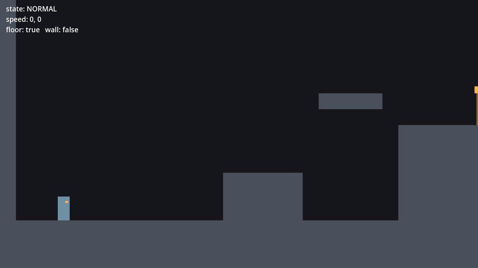
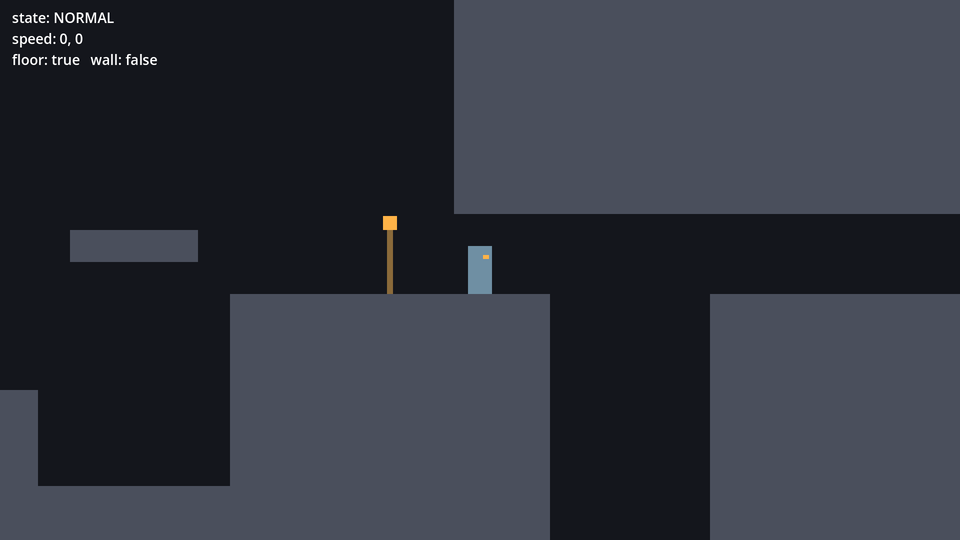
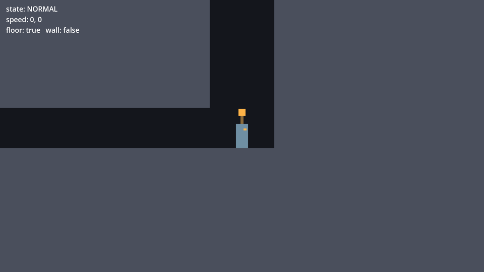
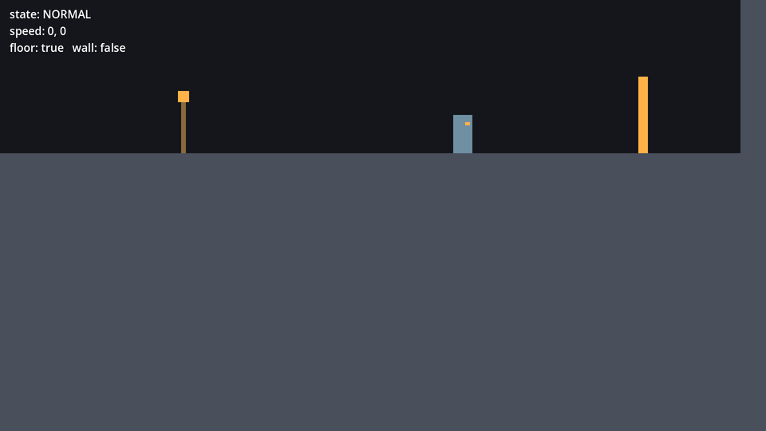

# الدرس 09: غرفة التجربة الكاملة

**الهدف:** تبني غرفة كبيرة فيها تحدّي لكل قدرة، مع نقاط رجوع ومنطقة سقوط، ونص يعرض حالة الرحّال.
**الوقت:** حوالي ساعة.
**قبله:** [الدرس 08](08-camera-feel.md)

---

## الفكرة

غرفة التجربة الكاملة طريق من اليسار لليمين، وكل جزء يحتاج قدرة:

1. **الدرجة:** قفزة عادية.
2. **الحافة العالية:** قفزة مزدوجة.
3. **الممر المنخفض فوق الحفرة:** السقف واطي فما تقدر تقفز عالي. لازم **تندفع**.
4. **البئر:** ما تطلعه إلا **بالقفز بين الجدارين**.
5. **العلم:** النهاية.

ولو طحت في الحفرة، ترجع لآخر **نقطة رجوع** مريت فيها. نقطة الرجوع عمود صغير فوقه شعلة، وبعدين بنبدّلها بنار المخيّم.

## 1. نعطي الرحّال اسم ونقطة رجوع

نبي الأشياء الثانية في الغرفة (نقطة الرجوع ومنطقة السقوط) تعرف إن اللي لمسها هو الرحّال، وتقدر ترجّعه.

### اسم للنوع

أول سطر في `player.gd`:

```gdscript
class_name Player
extends CharacterBody2D
```
`class_name Player` يعطي سكربتنا اسم نوع جديد. الحين أي سكربت ثاني يقدر يسأل: «هل هذا `Player`؟».

### مكان الرجوع

تحت `@onready var body`:

```gdscript
@onready var spawn_position := global_position
```
`global_position` مكان الرحّال في الغرفة. نحفظ مكانه أول ما تبدأ اللعبة كأول نقطة رجوع.

### دالة الرجوع

آخر السكربت:

```gdscript
func respawn() -> void:
	global_position = spawn_position
	velocity = Vector2.ZERO
	state = State.NORMAL
```

### السكربت كامل

`scripts/player.gd`

```gdscript
class_name Player
extends CharacterBody2D
## الرحّال: كل حركة البطل في هذا السكربت.

# ===== القدرات (شغّلها أو طفّها من الـ Inspector) =====
@export var can_double_jump := true
@export var can_dash := true
@export var can_wall_jump := true

# ===== الجري =====
# أقصى سرعة جري (بكسل في الثانية)
@export var max_speed := 520.0
# كم بسرعة يوصل للسرعة القصوى
@export var acceleration := 5000.0
# كم بسرعة يوقف لما تفك الزر
@export var friction := 6000.0

# ===== الجاذبية =====
@export var gravity := 3400.0
# الجاذبية وقت النزول أقوى، عشان القفزة ما تحس إنها عايمة
@export var fall_gravity_multiplier := 1.6
@export var max_fall_speed := 1300.0

# ===== القفز =====
# سالب لأن فوق في Godot يعني y أصغر
@export var jump_velocity := -1300.0
# لو فكّيت زر القفز بدري، نضرب السرعة في هالرقم فتصير القفزة قصيرة
@export var jump_cut_multiplier := 0.45
# وقت سماح تقدر تقفز فيه بعد ما تطلع من الحافة
@export var coyote_time := 0.1
# لو ضغطت قفز قبل ما تلمس الأرض بشوي، نتذكر الضغطة هالمدة
@export var jump_buffer_time := 0.12

# ===== القفزة المزدوجة =====
@export var double_jump_velocity := -1150.0
@export var max_air_jumps := 1

# ===== الاندفاع =====
@export var dash_speed := 1400.0
@export var dash_duration := 0.18
@export var dash_cooldown := 0.4

# ===== الجدار =====
@export var wall_slide_speed := 220.0
# x: قوة الدفعة بعيد عن الجدار، y: قوة القفزة لفوق
@export var wall_jump_velocity := Vector2(650.0, -1150.0)
# بعد القفز من الجدار، نوقف التحكم هالمدة عشان الدفعة تكمل
@export var wall_jump_lock_time := 0.15

# ===== الإحساس =====
# سرعة رجوع الشكل لحجمه الطبيعي بعد التمدد والانضغاط
@export var stretch_recover_speed := 12.0

# حالات الرحّال: يا يتحرك عادي، يا يندفع
enum State { NORMAL, DASH }
var state := State.NORMAL

# اتجاه الرحّال: 1 يمين، -1 يسار
var facing := 1
var coyote_timer := 0.0
var jump_buffer_timer := 0.0
var air_jumps_left := 0
var dash_timer := 0.0
var dash_cooldown_timer := 0.0
var can_air_dash := true
var is_wall_sliding := false
var wall_jump_lock_timer := 0.0
var body_stretch := Vector2.ONE

@onready var body: Node2D = $Body
@onready var spawn_position := global_position


func _physics_process(delta: float) -> void:
	update_timers(delta)
	match state:
		State.NORMAL:
			normal_state(delta)
		State.DASH:
			dash_state(delta)

	var was_on_floor := is_on_floor()
	move_and_slide()
	if not was_on_floor and is_on_floor():
		on_land()
	update_visual(delta)


func update_timers(delta: float) -> void:
	jump_buffer_timer -= delta
	dash_cooldown_timer -= delta
	wall_jump_lock_timer -= delta
	if is_on_floor():
		# على الأرض: نرجّع كل شي يتجدد بلمس الأرض
		coyote_timer = coyote_time
		air_jumps_left = max_air_jumps
		can_air_dash = true
	else:
		coyote_timer -= delta


func normal_state(delta: float) -> void:
	apply_gravity(delta)
	handle_run(delta)
	handle_wall_slide()
	handle_jump()
	handle_dash()


func apply_gravity(delta: float) -> void:
	if is_on_floor():
		return
	var current_gravity := gravity
	if velocity.y > 0.0:
		current_gravity *= fall_gravity_multiplier
	velocity.y = minf(velocity.y + current_gravity * delta, max_fall_speed)


func handle_run(delta: float) -> void:
	if wall_jump_lock_timer > 0.0:
		return
	var direction := Input.get_axis("move_left", "move_right")
	if direction != 0.0:
		velocity.x = move_toward(velocity.x, direction * max_speed, acceleration * delta)
		facing = 1 if direction > 0.0 else -1
	else:
		velocity.x = move_toward(velocity.x, 0.0, friction * delta)


func handle_wall_slide() -> void:
	is_wall_sliding = false
	if not can_wall_jump or not is_on_wall_only():
		return
	var direction := Input.get_axis("move_left", "move_right")
	var wall_normal := get_wall_normal()
	# الـ normal سهم يطلع من الجدار. لو ضغطك عكسه، يعني أنت ضاغط على الجدار
	if direction * wall_normal.x < 0.0:
		is_wall_sliding = true
		velocity.y = minf(velocity.y, wall_slide_speed)
		# يطالع بعيد عن الجدار
		facing = 1 if wall_normal.x > 0.0 else -1
		# لمس الجدار يرجّع القفزة المزدوجة والاندفاع
		air_jumps_left = max_air_jumps
		can_air_dash = true


func handle_jump() -> void:
	if Input.is_action_just_pressed("jump"):
		jump_buffer_timer = jump_buffer_time

	if jump_buffer_timer > 0.0 and coyote_timer > 0.0:
		jump(jump_velocity)
	elif jump_buffer_timer > 0.0 and is_wall_sliding:
		wall_jump()
	elif Input.is_action_just_pressed("jump") and can_double_jump and air_jumps_left > 0:
		air_jumps_left -= 1
		jump(double_jump_velocity)

	# قفزة قصيرة: لو فكّيت الزر والرحّال لسا طالع، نقص سرعته
	if Input.is_action_just_released("jump") and velocity.y < 0.0:
		velocity.y *= jump_cut_multiplier


func jump(strength: float) -> void:
	velocity.y = strength
	jump_buffer_timer = 0.0
	coyote_timer = 0.0
	body_stretch = Vector2(0.75, 1.25)


func wall_jump() -> void:
	var push := get_wall_normal().x
	velocity.x = push * wall_jump_velocity.x
	velocity.y = wall_jump_velocity.y
	facing = 1 if push > 0.0 else -1
	wall_jump_lock_timer = wall_jump_lock_time
	jump_buffer_timer = 0.0
	is_wall_sliding = false
	body_stretch = Vector2(0.75, 1.25)


func handle_dash() -> void:
	if not can_dash:
		return
	if Input.is_action_just_pressed("dash") and dash_cooldown_timer <= 0.0:
		if is_on_floor() or can_air_dash:
			start_dash()


func start_dash() -> void:
	state = State.DASH
	dash_timer = dash_duration
	dash_cooldown_timer = dash_cooldown
	if not is_on_floor():
		can_air_dash = false
	body_stretch = Vector2(1.3, 0.75)


func dash_state(delta: float) -> void:
	# سرعة ثابتة للأمام، وبدون جاذبية
	velocity = Vector2(facing * dash_speed, 0.0)
	dash_timer -= delta
	if dash_timer <= 0.0:
		state = State.NORMAL
		velocity.x = facing * max_speed


func on_land() -> void:
	body_stretch = Vector2(1.25, 0.8)


func update_visual(delta: float) -> void:
	body_stretch = body_stretch.lerp(Vector2.ONE, stretch_recover_speed * delta)
	body.scale = Vector2(facing * body_stretch.x, body_stretch.y)


func respawn() -> void:
	global_position = spawn_position
	velocity = Vector2.ZERO
	state = State.NORMAL
```

## 2. نقطة الرجوع

### المشهد

1. **Scene → New Scene** ثم **Other Node** واختر `Area2D`، وسمّه `Checkpoint`.
   - `Area2D` منطقة **ما تصطدم**، بس تحس لما شي يدخلها.
2. أضف تحته `CollisionShape2D`:
   - **Shape:** New RectangleShape2D، و **Size:** `96, 192`
   - **Position:** `0, -96`
3. أضف تحت `Checkpoint` عقدة `ColorRect` وسمّها `Pole` (العمود):
   - **Position:** `-6, -128` ، **Size:** `12, 128` ، **Color:** `8a6a3a`
4. أضف `ColorRect` ثاني وسمّه `Flame` (الشعلة):
   - **Position:** `-14, -156` ، **Size:** `28, 28` ، **Color:** `ffb347`
5. احفظ في `scenes` باسم `checkpoint.tscn`.

نقطة الأصل (0, 0) عند قاعدة العمود، فتحطها على الأرض على طول.

### السكربت

أضف سكربت لـ `Checkpoint` في `res://scripts/checkpoint.gd`:

`scripts/checkpoint.gd`

```gdscript
extends Area2D
## نقطة رجوع: لما يمر الرحّال من هنا، يصير هذا مكان رجوعه لو طاح.
## (بعدين بنبدّلها بنار المخيّم)


func _ready() -> void:
	body_entered.connect(_on_body_entered)


func _on_body_entered(body: Node2D) -> void:
	if body is Player:
		# نرجّعه فوق النقطة بشوي عشان ما يعلق في الأرض
		body.spawn_position = global_position + Vector2(0, -60)
```

- `body_entered` **إشارة (Signal)**: `Area2D` يطلقها لما يدخلها جسم. `connect` يعني «لما تنطلق الإشارة، شغّل هالدالة».
- `body is Player` يتأكد إن اللي دخل هو الرحّال، مو شي ثاني.
- نحط نقطة الرجوع فوق الأرض بـ 60 بكسل، عشان الرحّال ينزل عليها بدل ما يطلع داخل الأرض.

## 3. منطقة السقوط

1. في `test_room.tscn`، حدد `TestRoom` وأضف `Area2D`، وسمّه `FallZone`.
   - **Position:** `2880, 1450`
2. أضف تحته `CollisionShape2D`، و **Shape:** New RectangleShape2D بـ **Size:** `6400, 400`.
3. أضف سكربت لـ `FallZone` في `res://scripts/fall_zone.gd`:

`scripts/fall_zone.gd`

```gdscript
extends Area2D
## منطقة سقوط: لو طاح فيها الرحّال يرجع لآخر نقطة رجوع.


func _ready() -> void:
	body_entered.connect(_on_body_entered)


func _on_body_entered(body: Node2D) -> void:
	if body is Player:
		body.respawn()
```

منطقة عريضة تحت الغرفة كلها. أي مكان تطيح منه، بتلمسها وترجع.

## 4. ابنِ الغرفة

### الخريطة

هذي رسمة تقريبية للغرفة. كل حرف مربع 128×128 بكسل:

```
#...............############................#
#...............############................#
#...............############.....C........F.#
#...............############.################
#...............############.################
#...............############.################
#...............############.################
#...............############.################
#.........##.................################
#...........###C##..########C################
#...........######..#########################
#.P....###..######..#########################
##################..#########################
##################..#########################
```

| الرمز | معناه |
|---|---|
| `#` | صخر (قطع Block) |
| `.` | فراغ |
| `P` | بداية الرحّال |
| `C` | نقطة رجوع |
| `F` | العلم |

والفتحة اللي تحت في النص هي الحفرة.

### القطع

في `test_room.tscn`:

1. **احذف** `ClimbWall` (حدده واضغط Delete). كان للتجربة بس.
2. عدّل القطع الموجودة وأضف الجديدة لين تطابق الجدول:

| الاسم | Position | Size | |
|---|---|---|---|
| `LeftWall` | 0, -640 | 64, 1792 | عدّل |
| `Floor` | 0, 960 | 1600, 192 | عدّل |
| `Step` | 896, 768 | 320, 192 | زي ما هو |
| `HighPlatform` | 1280, 448 | 256, 64 | زي ما هو |
| `HighLedge` | 1600, 576 | 640, 576 | جديد |
| `UpperRock` | 2048, -640 | 1472, 1056 | جديد |
| `Landing` | 2560, 576 | 1472, 576 | جديد |
| `ShaftWall` | 3776, -256 | 256, 832 | جديد |
| `GoalRock` | 4032, -256 | 1664, 1408 | جديد |
| `RightWall` | 5696, -640 | 64, 1792 | عدّل |

- y بالسالب يعني فوق حدود الشاشة الأولى. عادي، الكاميرا بتلحقك.
- `UpperRock` سقف الممر المنخفض: تحته وفوق الأرض 160 بكسل بس، والرحّال طوله 96.

### العلم

أضف تحت `TestRoom` عقدة `ColorRect` وسمّها `GoalFlag`:
- **Position:** `5440, -448` ، **Size:** `24, 192` ، **Color:** `ffb347`

### نقاط الرجوع

اسحب `checkpoint.tscn` للغرفة ثلاث مرات:

| الاسم | Position | وينه |
|---|---|---|
| `Checkpoint1` | 1920, 576 | فوق الحافة العالية |
| `Checkpoint2` | 3648, 576 | تحت البئر |
| `Checkpoint3` | 4300, -256 | فوق، قبل العلم |

### حدود الكاميرا

حدد `Camera2D` (تحت `Player`) وغيّر **Limit**:
- **Left:** `0` ، **Top:** `-640` ، **Right:** `5760` ، **Bottom:** `1152`

## 5. نص الحالة

نص صغير فوق يسار الشاشة يعرض وش يصير مع الرحّال. يفيدك لما تجرب وتضبط الأرقام.

1. حدد `TestRoom` وأضف `CanvasLayer`.
   - `CanvasLayer` طبقة فوق اللعبة ما تتحرك مع الكاميرا. هنا تنحط الواجهة.
2. أضف تحته `Label` وسمّه `DebugLabel`:
   - **Position:** `24, 16`
   - **Theme Overrides → Font Sizes → Font Size:** `28`
3. أضف له سكربت في `res://scripts/debug_label.gd`:

`scripts/debug_label.gd`

```gdscript
extends Label
## نص للتجربة يعرض حالة الرحّال وقت اللعب.

@export var player: Player


func _process(_delta: float) -> void:
	if player == null:
		return
	text = "state: %s\nspeed: %d, %d\nfloor: %s   wall: %s" % [
		Player.State.keys()[player.state],
		player.velocity.x,
		player.velocity.y,
		player.is_on_floor(),
		player.is_wall_sliding,
	]
```

4. احفظ السكربت، وحدد `DebugLabel`. في الـ Inspector بتلقى خانة **Player**: اضغط **Assign** واختر `Player`.

- `@export var player: Player` خانة في الـ Inspector تقبل بس عقدة نوعها `Player`، وهذي فايدة `class_name`.
- `_process` زي `_physics_process`، بس للأشياء اللي تنرسم مو للفيزياء.
- `%s` و `%d` أماكن فاضية في النص، تتعبى بالقيم اللي في القائمة بالترتيب: `%s` لأي قيمة، و `%d` للأرقام الصحيحة.
- النص بالإنجليزي لأنه أداة تجربة لك بس، مو جزء من اللعبة.

## 6. العب الغرفة كاملة

كذا المفروض تشوف الغرفة في أماكن مختلفة:

| البداية | الممر المنخفض والحفرة |
|---|---|
|  |  |
| **البئر** | **العلم** |
|  |  |

احفظ وشغّل (F5)، وجرّب الطريق:

1. اطلع على الدرجة.
2. اقفز قفزة مزدوجة لفوق الحافة العالية (أو من الدرجة لـ `HighPlatform` وبعدين انزل عليها). بتمر من أول نقطة رجوع.
3. ادخل الممر المنخفض. اجري لحافة الحفرة، واقفز، و**اندفع**. بتعبر للجهة الثانية.
4. كمّل لين البئر. بتمر من ثاني نقطة رجوع.
5. اطلع البئر بالقفز بين الجدارين.
6. امش يمين لين العلم.

### جرّب تطفي القدرات

حدد `Player` في الغرفة وطفّ **Can Dash**. حاول تعبر الحفرة. ما تقدر، وبتطيح وترجع لنقطة الرجوع.

هذا بالضبط اللي بيصير في اللعبة الحقيقية: الرحّال يشوف الحفرة، وما يقدر يعبرها لين يكسب الاندفاع في الغابة المتحجرة. رجّع القدرة شغّالة بعد ما تخلص.

---

## ✔ تأكد إنك خلّصت

- [ ] الكاميرا تلحق الرحّال في كل الغرفة وما تطلع برا حدودها.
- [ ] لو طحت في الحفرة ترجع لآخر نقطة رجوع.
- [ ] تقدر توصل العلم من البداية.
- [ ] نص الحالة يتغيّر وأنت تتحرك.
- [ ] لما تطفي **Can Dash** ما تقدر تعبر الحفرة.

## لو واجهتك مشكلة

- **`Could not find type "Player"`:** تأكد إن `class_name Player` أول سطر في `player.gd` واحفظه. لو ما زال، سكّر Godot وافتحه.
- **ما يرجع لما يطيح:** تأكد إن `FallZone` فيه `CollisionShape2D` بشكل، وإن السكربت مضاف له.
- **نص الحالة فاضي:** ما سوّيت **Assign** لخانة **Player** في `DebugLabel`.
- **ما أقدر أعبر الحفرة حتى بالاندفاع:** اجري لين الحافة بالضبط، واقفز، واندفع على طول بعد القفزة. والقفزة المزدوجة بعد الاندفاع تعطيك مسافة زيادة.

## خلّصت غرفة التجربة!

صار عندك رحّال يجري ويقفز وينزلق على الجدران ويندفع، في غرفة تجرب فيها كل قدرة. هذي أول مرحلة من خطة البناء في [وثيقة التصميم](../docs/GDD.md#11-خطة-البناء).

**المرحلة الجاية:** السيف والأعداء: ضربات بالاتجاهات، وارتداد لما تضرب لتحت، ودمية تدريب، وأول عدو.

ارجع لي وقلّي «خلّصت الدرس 09»، أو أرسل لي صورة للغرفة وهي شغّالة، ونبدأ المرحلة الجاية.
